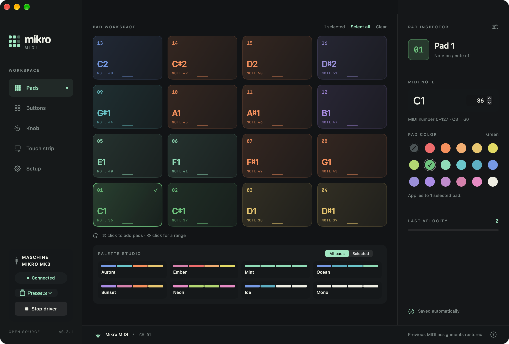
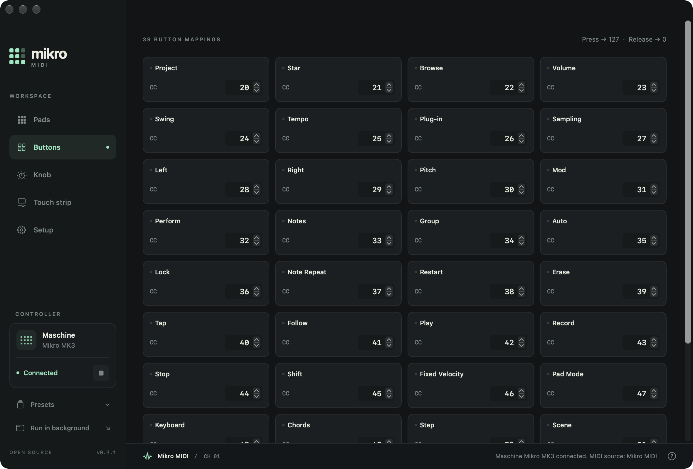
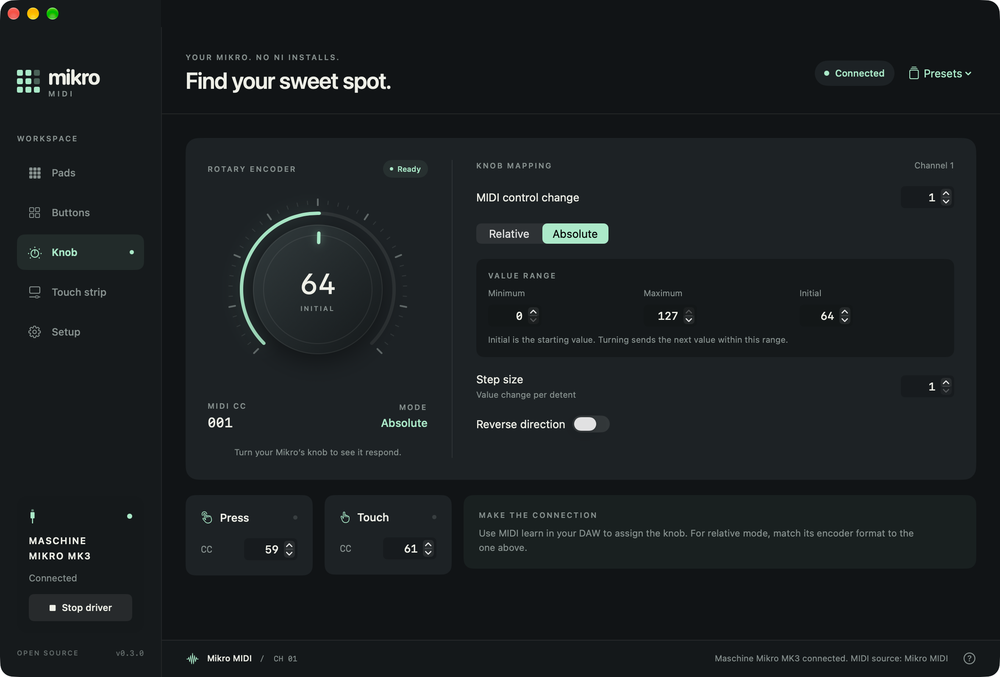
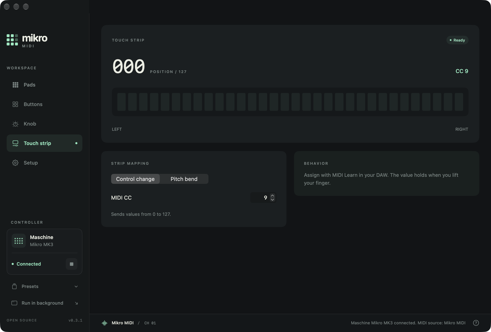
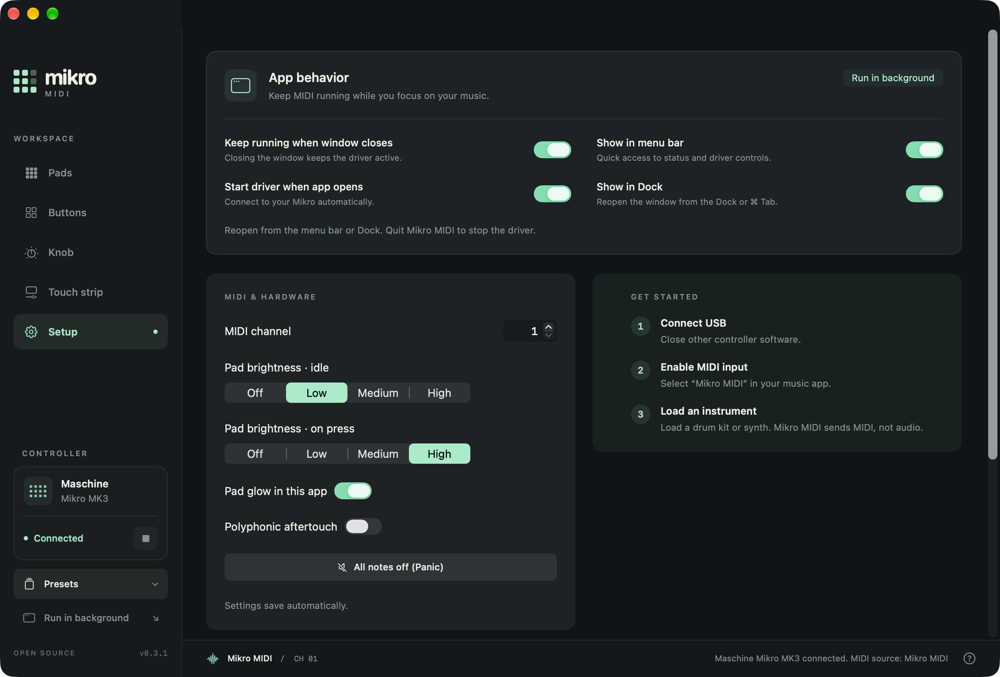

# Mikro MIDI

**Play your Mikro. Skip the bloat.**

A free Mac MIDI helper for the **Maschine Mikro MK3**. No Native Access, Komplete Kontrol, or NIHostIntegrationAgent required.

[**Download**](https://github.com/schneidermayer/mikro-midi/releases/latest) · [Release notes](https://github.com/schneidermayer/mikro-midi/releases) · [Issues](https://github.com/schneidermayer/mikro-midi/issues)



## Setup

Requires **Apple Silicon, macOS 14+, and Maschine Mikro MK3**. Release downloads are signed and notarized.

1. Unzip the download and move **Mikro MIDI.app** to Applications.
2. Plug in your Mikro and open the app. No button combination is needed.
3. Enable **Mikro MIDI** as an input in your music app and load an instrument.

Keep the helper open while playing. Your music app supplies the sound.

## Controls

- **Pads:** velocity-sensitive notes, optional aftertouch, eight color palettes, and adjustable LED brightness. ⌘-click or ⇧-click to color or transpose several pads together.
- **Buttons:** individual CC assignments with press/release feedback.
- **Knob:** relative or absolute CC, direction, step size, range, and separate press/touch mappings.
- **Touch strip:** CC or 14-bit pitch bend.
- **Presets:** import/export JSON from the sidebar. Settings save automatically. **Setup → Reset MIDI assignments** preserves colors and supports Undo.

### Buttons



### Knob



### Touch strip



### Setup



## MIDI defaults

| Control | Output on channel 1 |
| --- | --- |
| Pads 1–16, starting at bottom left | Notes 36–51 |
| Buttons | CC 20–58; press 127, release 0 |
| Knob press / touch | CC 59 / 60 |
| Knob rotation | CC 1; relative 65 clockwise / 63 counterclockwise |
| Touch strip | CC 9, values 0–127 |

Match your DAW's relative encoder format: **64 offset = 65/63**, **two's complement = 1/127**, or **sign magnitude = 1/65**. Step size is 1–16; relative mode sends repeated increments. Absolute mode defaults to 0–127, starting at 64.

Use MIDI Learn to assign controls. Play, Record, and Stop send CC 42, 43, and 44—not MIDI clock or transport messages. The strip holds its last value after release; Panic centers pitch bend. Pad colors use the controller's fixed palette.

## Troubleshooting

- **Waiting for controller:** check the USB cable and close other controller software. Reconnection is automatic.
- **No sound:** enable the MIDI input, load an instrument, and arm or monitor its track.
- **Stuck notes:** use **Setup → All notes off (Panic)**.

Settings: `~/Library/Application Support/Mikro MIDI/settings.json`.

## Build

Install [Rust](https://www.rust-lang.org/tools/install) and Apple's Command Line Tools, then:

```sh
git clone https://github.com/schneidermayer/mikro-midi.git
cd mikro-midi
make check
make app
open "dist/Mikro MIDI.app"
```

The build creates an ad-hoc signed app, ZIP, and checksum in `dist/`. For a notarized release, set `SIGNING_IDENTITY` and `NOTARY_PROFILE` to your Developer ID certificate and saved notarytool profile.

The Rust bridge also runs independently: `cargo run --release -- --help`. Linux dependencies and USB permissions are covered in the [upstream guide](https://github.com/r00tman/maschine-mikro-mk3-driver#readme). Packaged releases are for macOS; hardware testing was performed on macOS 27.0.1.

## Credits

By Hannes Schneidermayer, built on [r00tman's Maschine Mikro MK3 driver](https://github.com/r00tman/maschine-mikro-mk3-driver) by Viktor Rudnev. [MIT License](LICENSE).

Independent software, unaffiliated with Native Instruments. Provides MIDI control, not Controller Editor or Maschine integration.
